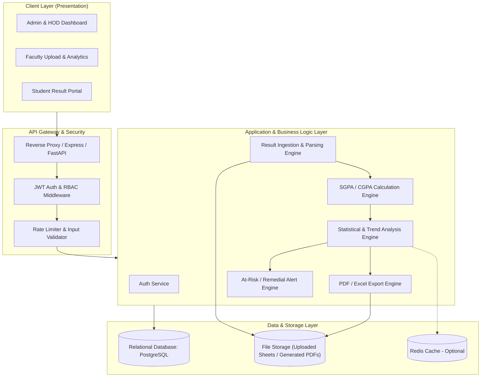
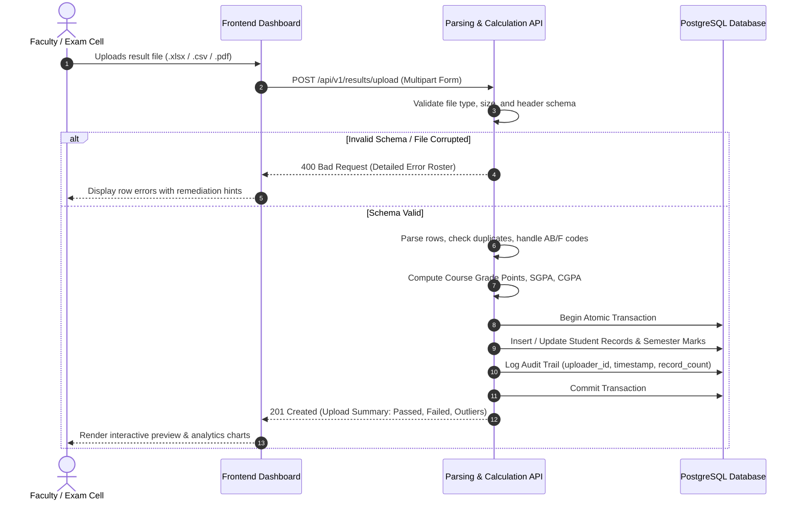
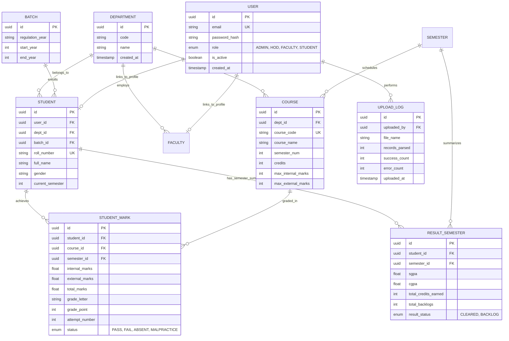
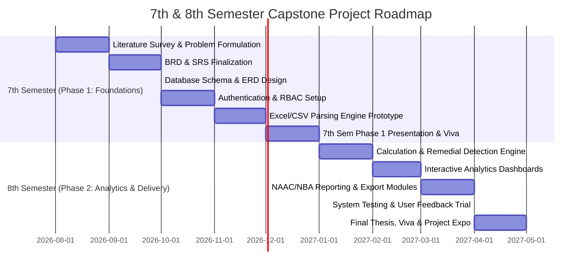

# Business Requirements Document (BRD)
## Online Student Result Analysis System (OSRAS)
**Academic Year:** Final Year (7th / 8th Semester) Capstone Project  
**Document Version:** 1.0.0  
**Status:** Approved for Implementation  

---

## 1. Executive Summary & Project Overview

### 1.1 Project Title
**Online Student Result Analysis System (OSRAS)** — An Automated Ingestion, Academic Performance Analytics, and Accreditation Compliance Platform for Higher Educational Institutions.

### 1.2 Background & Problem Statement
In collegiate and university environments, academic result processing and performance analysis are conducted manually or semi-manually using disparate spreadsheet files (`.xlsx`/`.csv`) or static PDF result sheets released by the university examination controller. This manual process causes several critical challenges:
1. **Time-Consuming & Error-Prone:** Class coordinators and examination cells spend tens of hours calculating SGPA, CGPA, class averages, pass percentages, and subject-wise failure counts.
2. **Delayed Intervention for Slow Learners:** Faculty members fail to identify at-risk students who consistently fail prerequisites or slip in academic standing until it is too late to offer remedial guidance.
3. **Accreditation Overhead (NBA / NAAC):** Accreditation bodies require quantitative proof of Program Outcomes (PO) and Course Outcomes (CO) attainment, pass percentages, and comparative batch performance. Generating these compliance matrices manually takes weeks.
4. **Lack of Centralized Self-Service for Students:** Students and academic mentors lack transparent, longitudinal graphical dashboards showing semester-over-semester progress, credit accumulation, and percentile ranks.

### 1.3 Project Vision & Objectives
The **Online Student Result Analysis System (OSRAS)** aims to replace tedious manual workflows with a centralized web platform that:
- Ingests tabular university marksheets (Excel/CSV and structured PDF scorecards).
- Computes weighted SGPA, CGPA, credit totals, grace points, and backlog histories instantaneously.
- Generates rich interactive data visualizations (batch-wise, department-wise, subject-wise, and faculty-wise).
- Identifies high achievers and at-risk students through automated statistical filtering.
- Generates exportable, audit-ready compliance reports (PDF and Excel) matching NAAC/NBA criteria.
- Provides strict Role-Based Access Control (RBAC) ensuring student data privacy and institutional integrity.

### 1.4 Scope of the System
| Aspect | In-Scope (Phase 1 & 2 / 7th & 8th Sem) | Out-of-Scope (Future Enhancements) |
| :--- | :--- | :--- |
| **Data Ingestion** | Bulk upload of Excel (`.xlsx`, `.xls`), CSV, and semi-structured university tabular result sheets. | Direct real-time scraping of third-party captcha-protected university portals. |
| **Calculation Engine** | Custom grading schemes, credit-based SGPA/CGPA, backlogs, grade conversions, ATKT rules. | Direct financial fee ledger integration / hostel fee reconciliation. |
| **Visual Analytics** | Interactive graphs for pass/fail ratios, grade distributions, subject difficulty indices, cohort trends. | Deep learning multimodal computer vision analysis of handwritten exam scripts. |
| **User Roles** | Admin, Head of Department (HOD), Faculty/Mentor, and Student. | Integration with university-wide live biometric attendance hardware. |
| **Reporting** | Printable PDF transcripts, semester result summaries, NAAC Criteria 2.6 tables, topper lists. | Direct integration with third-party payment gateways for re-evaluation fees. |

---

## 2. Stakeholders & User Personas

```
+-----------------------------------------------------------------------------------+
|                        ONLINE STUDENT RESULT ANALYSIS SYSTEM                      |
+-------------------+--------------------+--------------------+---------------------+
|    Super Admin    |    Head of Dept    |   Faculty/Mentor   |       Student       |
|  (Principal/Exam) |       (HOD)        |  (Class Advisor)   |      (Learner)      |
+-------------------+--------------------+--------------------+---------------------+
| - User management | - Dept-wide trends | - Upload marksheets| - View SGPA/CGPA    |
| - Department setup| - Faculty ratings  | - Verify mappings  | - Subject breakdown |
| - Audit logs      | - NBA/NAAC exports | - Identify remedial| - Trend graphs      |
| - Global settings | - Topper rankings  | - Student mentoring| - Download gradecard|
+-------------------+--------------------+--------------------+---------------------+
```

### 2.1 Role-Based Access Control (RBAC) Matrix

| Feature / Action | Super Admin | HOD | Faculty / Advisor | Student |
| :--- | :---: | :---: | :---: | :---: |
| Manage Departments, Semesters, Regulations | **Full** | View Only | View Only | No Access |
| User Provisioning & System Audit Logs | **Full** | No Access | No Access | No Access |
| Upload Result Sheets (Excel/CSV/PDF) | Yes | Yes | Yes (Assigned Class) | No Access |
| Edit / Re-evaluate Individual Student Marks | Yes | Yes | Request Only | No Access |
| View Department-Wide Analytics & Heatmaps | Yes | Yes | View Only | No Access |
| View Class-Level Performance & Topper Lists | Yes | Yes | Yes | No Access |
| Flag At-Risk / Slow Learners for Remedial | Yes | Yes | Yes | No Access |
| View Individual Student Profile & History | Yes | Yes | Yes (Class) | Self Only |
| Export NAAC/NBA Compliance Reports | Yes | Yes | Limited | No Access |
| Download Personal Result Summary / Gradecard | Yes | Yes | Yes | Self Only |

---

## 3. Detailed Functional Requirements (FR)

### Module 1: User Authentication & Role-Based Authorization
- **FR 1.1 Secure Login:** Support authentication via email/registration ID and password with bcrypt hashing and JSON Web Tokens (JWT).
- **FR 1.2 Session Management:** Role-specific token expiration (e.g., 2 hours for administrators, 24 hours for students) with refresh token rotation.
- **FR 1.3 Role Isolation:** Strict route and API-level middleware guards preventing horizontal privilege escalation (e.g., student accessing another student's marks or faculty dashboards).
- **FR 1.4 Password Management:** Self-service password reset via email/OTP and administrative password reset capabilities.

### Module 2: Result Ingestion & Parsing Engine
- **FR 2.1 Multi-Format Ingestion:** Accept `.xlsx`, `.xls`, `.csv`, and standardized tab-delimited text/PDF result rosters.
- **FR 2.2 Template Mapping & Validation:** Allow the administrator or faculty to map file columns (Roll No, Student Name, Subject Codes, Internal Marks, External Marks, Total Marks, Grade, Credits).
- **FR 2.3 Data Sanitization & Verification:** 
  - Validate against duplicates (e.g., student already recorded in this semester).
  - Detect invalid marks (negative numbers, marks exceeding max subject limits).
  - Handle special examination codes: `AB` (Absent), `MP` (Malpractice), `WH` (Withheld), `RA` (Re-appear), `F` (Fail).
- **FR 2.4 Staging & Confirmation Workflow:** Parsed results are displayed in a verification table previewing calculated metrics before committing changes to the primary database.

### Module 3: Academic Calculation & Evaluation Engine
- **FR 3.1 Credit-Based Grading Schemes:** Support configurable grading scales (e.g., 10-point UGC/AICTE standard, percentage-based systems, or custom university scales).
- **FR 3.2 SGPA Calculation:** Compute Semester Grade Point Average:
  $$\text{SGPA} = \frac{\sum (\text{Course Credits} \times \text{Grade Points})}{\sum \text{Course Credits}}$$
- **FR 3.3 CGPA Calculation:** Cumulative Grade Point Average calculated across all successfully cleared semesters:
  $$\text{CGPA} = \frac{\sum (\text{Semester Total Credits} \times \text{SGPA})}{\sum \text{Cumulative Credits}}$$
- **FR 3.4 Backlog & ATKT Tracking:** Automatically flag cleared vs uncleared subjects; track attempt counts and update CGPA upon re-appearance.
- **FR 3.5 Grace Marks & Moderation:** Provide transparent adjustment logging if university moderation rules apply.

### Module 4: Analytics, Statistical & Data Visualization Engine
- **FR 4.1 Cohort & Batch Performance Metrics:**
  - Overall Pass Percentage, Total Appeared, Total Passed, Total Failed.
  - Grade distribution histogram (O, A+, A, B+, B, C, P, F).
  - First Class with Distinction, First Class, Second Class counts.
- **FR 4.2 Subject-Wise Difficulty & Variance Analysis:**
  - Mean, Median, and Standard Deviation of scores per subject.
  - Identification of hardest subjects (highest failure rates) and easiest subjects.
  - Comparison of Internal Assessment (IA) scores vs End-Semester Exam (ESE) scores.
- **FR 4.3 Faculty & Mentor Analytics:**
  - Subject pass rates mapped to teaching faculty for internal academic reviews.
- **FR 4.4 Longitudinal Performance Tracking:**
  - Track student cohort progress from 1st semester through 7th/8th semester to monitor dropout and retention trends.
- **FR 4.5 Merit & Rank Generation:**
  - Top 10 batch toppers, branch toppers, and subject-specific toppers with automatic rank tie-breaking logic.
- **FR 4.6 At-Risk (Slow Learner) Early Warning System:**
  - Automated rule engine that flags students with CGPA $< 6.0$, more than 2 active backlogs, or a drop in SGPA $> 1.5$ points compared to the previous semester.

### Module 5: Compliance, Reporting & Export Engine
- **FR 5.1 NAAC / NBA Accreditation Summary:** Export pre-formatted tables for NAAC Criterion 2.6 (Student Performance and Learning Outcomes) and NBA Course Attainment documentation.
- **FR 5.2 Dynamic Exporting:** One-click export of any filtered analytical view to `.xlsx`, `.csv`, and printable PDF.
- **FR 5.3 Student Performance Card:** Printable unofficial digital grade sheet for academic advising and parent-teacher meetings.

### Module 6: Audit Logs & Administrative Governance
- **FR 6.1 Audit Trail:** Log all critical operations: user logins, file ingestion timestamps, mark revisions, and bulk data deletions.
- **FR 6.2 Data Backup & Restoration:** Administrative utilities to export complete academic session snapshots.

---

## 4. Non-Functional Requirements (NFR)

### 4.1 Performance & Scalability
- **Ingestion Throughput:** Parse, validate, and compute records for 500 students (approx. 4,000 course grades) in under 5 seconds.
- **Query Latency:** Analytical dashboard queries and aggregate charts must load within $\le 500\text{ ms}$ for a batch of 1,000 students.
- **Concurrent Users:** Support at least 150 concurrent faculty and student users during peak result declaration periods.

### 4.2 Security & Data Privacy
- **Encryption:** TLS 1.3 for all data in transit; AES-256 for persistent database storage and backups.
- **Credential Storage:** Industry standard password hashing (Argon2id or bcrypt with work factor $\ge 12$).
- **Input Sanitization & Protection:** Strict parameterized queries/ORMs to eradicate SQL injection; sanitization to prevent Stored/Reflected XSS.
- **File Upload Safeguards:** Enforce MIME type checking, extension white-listing, file size limits ($\le 15\text{MB}$), and isolated parser execution.

### 4.3 Usability & Accessibility
- **Responsive Design:** Seamless experience across desktop monitors (1920x1080), laptops, and mobile screens ($\ge 375\text{px}$).
- **Data Accessibility:** Interactive data tables featuring client-side and server-side searching, sorting, multi-column filtering, and pagination.
- **Visual Clarity:** Clear color contrast compliance (WCAG 2.1 AA) for analytical charts and red/amber indicators for at-risk alerts.

### 4.4 Reliability & Maintainability
- **ACID Transactions:** Grade updates and batch uploads must execute inside atomic database transactions to prevent partial/corrupted uploads.
- **Modular Codebase:** Decoupled backend architecture (Controller-Service-Repository pattern) and modular component-driven frontend architecture.

---

## 5. System Architecture & Workflows

### 5.1 High-Level Architecture (3-Tier Clean Architecture)



### 5.2 Result Ingestion & Processing Workflow



### 5.3 Entity-Relationship Diagram (ERD)



---

## 6. Recommended Technology Stack

| Layer | Recommended Technology | Justification for College 7th Sem Project |
| :--- | :--- | :--- |
| **Frontend UI** | **React.js / Next.js (TypeScript)** with Tailwind CSS & Shadcn UI | Fast component reusability, modern developer experience, responsive charts. |
| **Data Visualizations** | **Recharts / Chart.js** | Rich interactive line charts (SGPA progress), bar charts (pass %), and pie/radar charts. |
| **Backend API** | **Python (FastAPI)** or **Node.js (Express / NestJS)** | Python is unmatched for statistical computation (Pandas, NumPy, OpenPyXL, pdfplumber). Alternatively, Node.js provides a clean full-stack TypeScript ecosystem. |
| **Database** | **PostgreSQL** | Native support for structured relational tables, strong foreign-key constraints, high concurrency, and JSONB for flexible grading schemas. |
| **ORM / Query Builder**| **SQLAlchemy / Prisma** | Type-safe queries, migration management, and automated schema synchronization. |
| **Report Generation** | **PDFKit / Weasyprint / ExcelJS** | Deterministic generation of printable semester transcripts and NAAC criteria documents. |
| **Authentication** | **JWT (JSON Web Tokens) + Bcrypt** | Industry standard stateless authentication with RBAC. |
| **Deployment / DevOps**| **Docker & Docker Compose** | Reproducible multi-container local setup (Frontend + Backend + PostgreSQL) for college presentation/viva. |

---

## 7. Recommended Production-Grade Folder Structure

```text
online-result-analysis-system/
├── .github/                              # CI/CD Workflows & GitHub issue templates
│   └── workflows/
│       └── ci.yml
├── docs/                                 # Academic Project Documentation (7th Sem)
│   ├── BUSINESS_REQUIREMENTS_DOCUMENT.md # This comprehensive BRD
│   ├── SYSTEM_DESIGN_DOCUMENT.md         # Architecture, UML, Low-Level Design
│   ├── DATABASE_SCHEMA.sql               # DDL scripts and test seed fixtures
│   └── API_SPECIFICATION.md              # OpenAPI/Swagger contract endpoints
├── backend/                              # Server Application (Python FastAPI or Node.js)
│   ├── app/                              # Application source code
│   │   ├── api/                          # Route controllers
│   │   │   ├── v1/
│   │   │   │   ├── auth.py               # Authentication & token endpoints
│   │   │   │   ├── users.py              # User management & profile routes
│   │   │   │   ├── departments.py        # Department & Batch routes
│   │   │   │   ├── courses.py            # Subject & syllabus configuration
│   │   │   │   ├── upload.py             # File ingestion & parsing endpoints
│   │   │   │   ├── analytics.py          # Aggregate calculation & chart endpoints
│   │   │   │   └── reports.py            # PDF & Excel export generation
│   │   │   └── deps.py                   # Dependency injection (Auth, DB session)
│   │   ├── core/                         # Global configurations & security
│   │   │   ├── config.py                 # Environment variables & app settings
│   │   │   ├── security.py               # Password hashing & JWT generation
│   │   │   └── exceptions.py             # Custom API error handlers
│   │   ├── db/                           # Database layer
│   │   │   ├── base.py                   # SQLAlchemy Base model
│   │   │   ├── session.py                # Database connection pool engine
│   │   │   └── migrations/               # Alembic database migration scripts
│   │   ├── models/                       # Database Entities (ORM models)
│   │   │   ├── user.py
│   │   │   ├── student.py
│   │   │   ├── course.py
│   │   │   ├── marks.py
│   │   │   └── upload_log.py
│   │   ├── schemas/                      # Data Validation Schemas (Pydantic / Zod)
│   │   │   ├── user_schema.py
│   │   │   ├── marks_schema.py
│   │   │   └── analytics_schema.py
│   │   ├── services/                     # Core Business Logic Layer
│   │   │   ├── auth_service.py           # Login, permissions, RBAC checks
│   │   │   ├── parser_service.py         # Excel, CSV, PDF tabular parsing
│   │   │   ├── calculation_service.py    # SGPA, CGPA, Backlog arithmetic
│   │   │   ├── analytics_service.py      # Statistical summaries, pass/fail ratios
│   │   │   ├── at_risk_service.py        # Remedial student detection engine
│   │   │   └── report_service.py         # PDF and Excel rendering engine
│   │   └── utils/                        # Shared helpers
│   │       ├── grading_rules.py          # UGC / AICTE grade boundary definitions
│   │       └── logger.py                 # Structured system logging
│   ├── tests/                            # Unit & Integration Tests
│   │   ├── test_auth.py
│   │   ├── test_parser.py
│   │   └── test_calculations.py
│   ├── Dockerfile                        # Backend Container Definition
│   ├── requirements.txt                  # Python dependencies (or package.json)
│   └── .env.example                      # Sample configuration variables
├── frontend/                             # Client Application (React / Next.js)
│   ├── public/                           # Static assets, logos, favicon
│   ├── src/
│   │   ├── assets/                       # Images, SVG icons, illustrations
│   │   ├── components/                   # Reusable UI Components
│   │   │   ├── common/                   # Buttons, Inputs, Modals, Navbar, Footer
│   │   │   ├── charts/                   # Reusable chart wrappers (Recharts)
│   │   │   │   ├── BarChartCard.tsx
│   │   │   │   ├── LineTrendChart.tsx
│   │   │   │   └── GradePieChart.tsx
│   │   │   ├── tables/                   # Data tables with sorting & pagination
│   │   │   │   └── ResultsDataTable.tsx
│   │   │   └── upload/                   # File drag-and-drop & column mapper
│   │   │       ├── FileDropzone.tsx
│   │   │       └── SchemaMapperModal.tsx
│   │   ├── context/                      # React Context (AuthContext, ThemeContext)
│   │   ├── hooks/                        # Custom hooks (useAuth, useAnalytics)
│   │   ├── layouts/                      # Layout wrappers (DashboardLayout, AuthLayout)
│   │   ├── pages/                        # Views / Route Pages
│   │   │   ├── auth/                     # Login, ResetPassword
│   │   │   ├── admin/                    # User management, System Config
│   │   │   ├── hod/                      # Department trends, Faculty performance
│   │   │   ├── faculty/                  # Result upload, Class analytics, At-risk
│   │   │   └── student/                  # Personal scorecard, Semester progress
│   │   ├── services/                     # Axios API clients
│   │   │   ├── api.ts                    # Interceptor instance
│   │   │   ├── auth.service.ts
│   │   │   ├── upload.service.ts
│   │   │   └── analytics.service.ts
│   │   ├── types/                        # TypeScript interfaces & types
│   │   └── styles/                       # Tailwind CSS globals
│   ├── package.json
│   ├── tsconfig.json
│   ├── tailwind.config.js
│   └── Dockerfile
├── sample_data/                          # Test datasets for demonstration & viva
│   ├── sample_result_batch_2021_2025.xlsx
│   ├── sample_university_roster.csv
│   └── sample_ledger_sheet.pdf
├── docker-compose.yml                    # Unified orchestration (DB + API + Web)
├── .gitignore
└── README.md                             # Project setup guide & team credits
```

---

## 8. College Project Roadmap (7th vs 8th Semester Delivery)



---

## 9. Verification & Acceptance Criteria

### Scenario 1: Bulk Marksheet Upload
- **Given:** A class advisor has an official university result Excel sheet with 60 students and 8 subjects.
- **When:** The advisor uploads the sheet via the `/upload` portal and confirms the column mapping.
- **Then:** 
  1. The system validates all marks are within $[0, \text{MaxMarks}]$ range.
  2. Calculates SGPA for all 60 students in $\le 2\text{ seconds}$.
  3. Displays a preview table showing pass count, fail count, and top 3 rank holders with no database integrity errors.

### Scenario 2: At-Risk Student Identification
- **Given:** A student has failed 2 prerequisite subjects in Semester 3 and their SGPA drops from 7.5 to 5.2.
- **When:** Semester 3 marks are committed.
- **Then:** The system automatically flags the student with an **"At-Risk"** badge in the Faculty and HOD Remedial Dashboard, prompting the advisor to schedule a mentoring session.

### Scenario 3: Student Privacy & Access
- **Given:** A logged-in student with roll number `CS2021045`.
- **When:** The student navigates to the portal or invokes the `/api/v1/students/CS2021046/results` endpoint.
- **Then:** The system rejects cross-student access with an HTTP `403 Forbidden` and only renders `CS2021045`'s historical grade progress.
